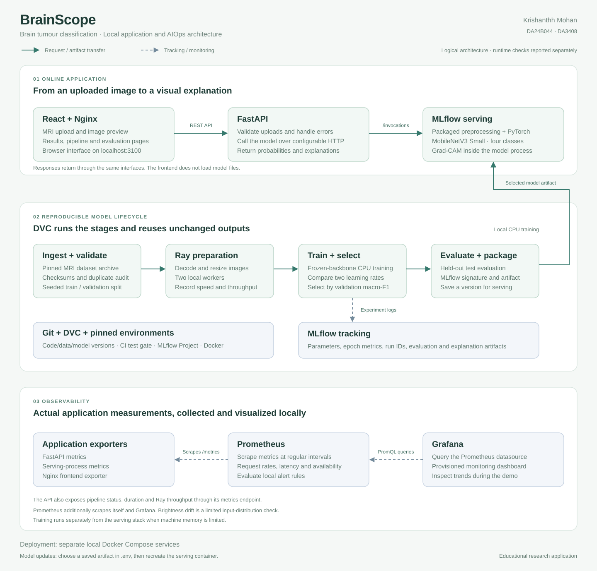

# High-Level Design

I built BrainScope for my approved Brain Tumour Classification proposal (Krishanthh Mohan, DA24B044). My objective is a usable MRI classification demonstration with reproducible training and observable local deployment.

## Architecture

The diagram separates three flows so the application request path, model lifecycle, and monitoring connections can be read independently. Solid arrows represent requests or model-artifact transfer. Dashed arrows represent experiment logging or monitoring queries; arrow labels describe the direction of the request rather than the return data.

| Area | Block | Responsibility |
|---|---|---|
| Online application | React / Nginx | Presents image upload, predictions, explanations, pipeline status, and model evaluation. |
| Online application | FastAPI | Validates uploads, calls the model through HTTP, handles failures, and publishes operational endpoints. |
| Online application | MLflow serving | Loads the packaged preprocessing and PyTorch model, returns class probabilities, and generates Grad-CAM. |
| Model lifecycle | Ingestion and validation | Downloads the pinned archive, checks images and duplicates, and creates reproducible splits. |
| Model lifecycle | Ray preparation | Runs bounded image-preparation tasks and records actual processing throughput. |
| Model lifecycle | Training and evaluation | Compares learning rates, selects by validation macro-F1, evaluates on held-out test data, and packages the model. |
| Reproducibility | Git, DVC, and environment files | Track source, pipeline dependencies, data/model artifacts, and execution environments. |
| Experiment records | MLflow tracking | Stores run parameters, custom lineage, metrics, and generated artifacts. |
| Monitoring | Exporters, Prometheus, and Grafana | Expose measurements, collect time series and evaluate alerts, and visualize operational behavior. |

The selected packaged artifact moves from the offline lifecycle into the serving process through a controlled local model update. This is separate from an individual prediction request. The diagram describes the logical design; recorded runtime checks establish which parts have been verified.

## Design decisions

I selected Ray rather than Spark because the work consists of independent image operations and does not need a JVM or a large tabular processing engine. I use two workers and bound the number of pending image tasks. I selected MobileNetV3 Small for CPU feasibility. Frozen-backbone embeddings are computed once for train/validation and reused between two learning-rate experiments; this is equivalent to head training with deterministic frozen features. No training augmentation or backbone fine-tuning is claimed in this baseline.

I use DVC rather than Airflow to avoid maintaining a second orchestrator on a small machine. A local Git pre-commit hook runs the code/test gate; DVC includes that gate as a dependency of training. The console executes fixed DVC stage targets and records actual status, duration, and log paths. Cached stages may finish quickly because DVC reuses unchanged artifacts. A file lock excludes simultaneous runners. Git identifies code; DVC identifies data and outputs; MLflow identifies experimental runs.

I keep inference behind a configurable REST boundary, so the UI does not import the training code or require model files. Grad-CAM lives in the serving model, avoiding duplicate loaded models. A process-local lock prevents overlapping backward passes from interfering with explanations. Docker uses one serving worker.

## Data and evaluation

I use four class identifiers in this fixed order: glioma, meningioma, notumor, pituitary. The upstream Testing directory remains the test set. Validation is a seeded stratified subset of Training. Exact decoded-pixel duplicates are removed with test copies retained preferentially. Perceptual-hash matches are reported for review. Without patient metadata, neither these checks nor image-level metrics prove patient-level generalization. The classifier cannot reliably reject all unrelated images; format validation is not MRI detection.

Model selection uses validation macro-F1 only. The selected model is evaluated on the test partition. A validation macro-F1 threshold of 0.85 controls the experimental label; test scores are reported without changing this threshold after observing them. A heatmap is an explanation of class influence, not a segmentation mask.

## Deployment and maintenance

The default Compose deployment binds published ports to localhost and applies per-service memory limits. Training is capped at 1.5 GiB and serving at 768 MiB. Training runs through an on-demand profile, separately from the full monitoring stack when memory is limited. Tracking data, model artifacts, reports, and metrics volumes persist locally. The `MODEL_ARTIFACT_PATH` entry in `.env` selects a saved model directory. Updating it and recreating only the serving service applies an update or rollback; saved directories remain unchanged. Docker Compose is the supported application startup method.

Monitoring covers HTTP status/latency, serving and tracking availability, class counts, pipeline stages, throughput, Python process memory/CPU, and image brightness distribution. Brightness drift is not measured accuracy. It requires 20 observations and resets with the API process. Prometheus evaluates local alerts; no external notification delivery is configured.
